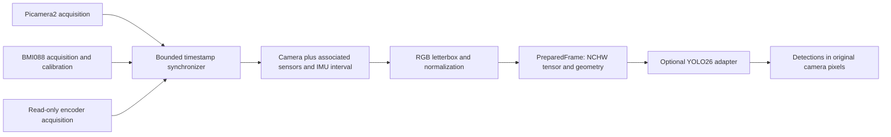

# Perception intake and YOLO26 integration

The pipeline prepares camera images for object detection while retaining their
relationship to IMU and wheel measurements. It runs without ROS, Torch, model
weights, or a class list. The optional model adapter is the boundary at which
YOLO26 can be added once weights and targets are chosen.



Acquisition workers own device lifecycle and run independently of the consumer.
They only validate and enqueue messages. Preprocessing and inference run on the
consumer thread, so expensive inference cannot block sensor reads. Queue sizes
bound memory; oldest entries are evicted at capacity. A single consumer owns
`PerceptionRuntime.read()` and any detector instance.

## Robotics conventions

These are design choices based on ROS conventions, not a claim of ROS middleware
compatibility or hard real-time guarantees:

- Acquisition timestamps, explicit image encoding and optical frame identity
  follow [sensor_msgs/Image](https://github.com/ros2/common_interfaces/blob/rolling/sensor_msgs/msg/Image.msg).
- SI units, body axes X-forward/Y-left/Z-up, and optical axes X-right/Y-down/Z-forward
  follow [REP-103](https://github.com/ros-infrastructure/rep/blob/master/rep-0103.rst).
- Timestamp association and retained sample history follow the filtering/cache
  pattern in [ROS message_filters](https://github.com/ros2/message_filters/blob/rolling/doc/index.rst).
  Roadbot implements its own camera-anchored policy described below; it is not
  an exact reproduction of ROS ApproximateTime.
- Explicit clock domains and reset on replay discontinuities follow the concerns
  in [ROS 2 Clock and Time](https://design.ros2.org/articles/clock_and_time.html).

## Timestamp contract

`MessageHeader.timestamp_ns` is acquisition time in the named `clock_domain`.
Live messages use the same host's `monotonic` domain in integer nanoseconds.
`received_timestamp_ns` records host receipt separately. Processing must preserve
the camera header; detection output must not replace it with inference time.

| Input | Timestamp source | Meaning and limits |
| --- | --- | --- |
| Camera | `sensor_boottime` | libcamera `SensorTimestamp` converted from Linux BOOTTIME to host MONOTONIC using bracketed clock reads per frame |
| Camera fallback | `host_receive` | Receipt estimate when sensor timestamp is absent; rejected by default for synchronized perception |
| BMI088 | `host_read_midpoint` | Midpoint of the host I2C read interval, including sequential accelerometer, gyro and temperature reads |
| Encoders | `host_read_midpoint` | Midpoint of the host read of all four cumulative counters |

libcamera defines `SensorTimestamp` against BOOTTIME, which includes suspend
time; MONOTONIC has different suspend semantics. See its
[control definition](https://github.com/libcamera-org/libcamera/blob/master/src/libcamera/control_ids_core.yaml).
Per-frame clock mapping avoids assuming the two clocks have the same origin.
The raw timestamp and exposure metadata remain in `CameraFrame.metadata`.
`timestamp_uncertainty_ns` records half of the host read/clock-pair interval. It
does **not** bound device sampling latency, rolling-shutter timing, or IMU
accelerometer/gyro sample skew. This implementation does software association,
not hardware triggering or physical synchronization of exposures and samples.

Never compare timestamps from another host or boot just because both say
`monotonic`. An external MCU, PTP clock, or ROS bridge must provide a measured
clock mapping before intake. A ROS publisher must explicitly translate to ROS
time; these stamps are not Unix/ROS epoch timestamps. Replay must supply a clock
in the recorded domain to `add()`/`poll()` and call `reset()` on seek, clock jump,
or sequence restart. The synthetic diagnostic demonstrates injected replay time.

## Association and latency policy

Each stream must be strictly increasing in timestamp and sequence. Cross-stream
arrival order can vary. Duplicate or out-of-order samples, clock mismatches,
future timestamps, stale data, malformed images and non-finite sensor values are
rejected and counted. Same-stream reordering is deliberately not buffered.

A camera frame anchors each bundle. The synchronizer waits until IMU and encoder
streams have reached/passed its timestamp, then chooses each nearest sample
within its tolerance. This guarantees nearest selection for ordered streams;
ties favor the earlier sample. Samples can be reused for more than one frame.
There is no interpolation of encoder counts or invented IMU measurement at the
image time. `imu_offset_ns` and `encoder_offset_ns` are signed sample-minus-camera
time offsets and remain visible to downstream consumers.

When a stream stops, `poll()` must still run. At the wait deadline the nearest
available samples may be used if they are within tolerance; otherwise the frame
is dropped. Age limits apply at intake, while waiting, and after preprocessing.
An inference consumer should similarly reject results that have expired before
planning or control uses them.

Defaults in `config/robot.yaml`:

| Setting | Default |
| --- | --- |
| Camera / IMU / encoder acquisition | 30 / 100 / 50 Hz |
| IMU / encoder association tolerance | 15 / 30 ms |
| Maximum wait after camera receipt | 60 ms |
| Maximum acquisition age | 250 ms |
| Camera / IMU / encoder buffer capacity | 3 / 256 / 128 messages |

These are initial engineering settings, not calibrated hardware accuracy claims.
Tune them using the live diagnostic's offsets, counters, latency needs, and
measured sensor rates. Natural history eviction also increments sensor overflow
counters; it does not necessarily mean a camera frame was lost.

Each bundle retains all buffered IMU samples in `(previous synchronizer output time,
current camera time]`. `imu_window_complete` is false for the first frame,
buffer loss, observed sequence gaps, or missing boundary coverage. Consumers
must inspect it before integrating that interval, and verify that
`previous_camera_timestamp_ns` matches their last consumed camera frame:
preprocessing or a downstream consumer may drop a synchronizer output. This is preparation for future
fusion, not an odometry or IMU preintegration implementation.

## Pixel and calibration contract

Camera pixels are copied before releasing the libcamera request. Packed formats
map to actual array encodings: `RGB888` to `bgr8`, `BGR888` to `rgb8`,
`XRGB8888` to `bgra8`, and `XBGR8888` to `rgba8`. This matches
[Picamera2's format table](https://github.com/raspberrypi/picamera2/blob/main/picamera2/request.py).
Unsupported encodings fail validation rather than silently swapping channels.

The preprocessor converts to RGB, resizes with bilinear interpolation while
preserving aspect ratio, centers the image in a fixed canvas padded with 114,
and produces contiguous float32 `[1, 3, H, W]` values divided by 255. Dimensions
must be multiples of the configured model stride (default 32). Fixed shapes suit
export runtimes. No crop, augmentation, ImageNet normalization or extra
undistortion is applied. Actual rounded resize dimensions and asymmetric padding
are retained in `LetterboxTransform`; `to_camera_boxes()` reverses the geometry
and clips boxes to source pixels.

The current camera calibration is incomplete. Intrinsics, undistortion and
camera-to-body extrinsics are not fabricated or applied. Boxes refer to the
original configured camera stream, including configured flips, and remain 2D.
Metric projection and sensor fusion require measured camera calibration and
extrinsics. If rectification is added later, it needs its own calibrated image
geometry and must match model training inputs.

The live diagnostic uses `CalibratedImu` only when calibration is complete;
otherwise it reports raw SI-unit samples in `imu_link`. Counts per wheel
revolution is initially null, so wheel angular speeds are `None`, including the
first sample even when a scale is supplied. Once configured, speeds use signed
32-bit rollover-aware count differences. Their sign follows controller counts;
wheel-direction conventions and counter reset detection belong in the future
odometry layer.

## Connecting YOLO26

The tensor contract matches the
[Ultralytics prediction interface](https://docs.ultralytics.com/modes/predict/).
Torch tensors are already RGB/NCHW/normalized, whereas NumPy image inputs to
Ultralytics expect BGR/HWC/uint8 and trigger preprocessing. Do not send the
prepared NumPy tensor as an Ultralytics image, or normalize/letterbox it again.

For local weights, install the optional dependency with `pip install -e '.[yolo]'`.
On the Pi retain the OS OpenCV installation. No weights download occurs as part
of the intake or diagnostic.

```python
from pathlib import Path

from roadbot.perception.object_detector import UltralyticsDetector

detector = UltralyticsDetector.from_weights(
    Path("models/deployment/your-yolo26.pt"),
    device="cpu",
    classes=None,  # choose IDs after selecting/training the model
)
# runtime is a started PerceptionRuntime with camera, IMU and encoder sources.
prepared = runtime.read(timeout_s=1.0)
if prepared is not None:
    detections = detector.detect(prepared)
    # detections.header is the camera header; boxes use original camera pixels.
```

For ONNX Runtime, feed `prepared.tensor` directly to a matching float32,
fixed-shape NCHW export:

```python
outputs = session.run(None, {session.get_inputs()[0].name: prepared.tensor})
```

Check the chosen export's actual input/output signature, precision and stride.
Quantized inputs and model-specific output decoding are not implemented here.
YOLO26 end-to-end exports and other YOLO exports may expose different outputs;
the core intake deliberately does not hard-code an NMS decoder. Future detector
backends can implement the `ObjectDetector` protocol. The included Ultralytics
adapter delegates model execution and output decoding to Ultralytics.

## Verification

```bash
python -m pytest -q
python tools/check_perception_pipeline.py --synthetic --duration 2
python tools/check_perception_pipeline.py --duration 10  # on the Pi
```

The synthetic run exercises delayed camera delivery at 30 Hz against 100 Hz IMU
and 50 Hz encoders. Unit tests cover clock mapping, ownership after camera buffer
release, missing/stale/out-of-order feeds, bounded buffers, IMU history coverage,
color/layout/geometry, encoder rollover, worker failures and cleanup. The model
adapter test uses a fake model and Torch interface; real YOLO26 inference and Pi
hardware timing still require validation with the chosen hardware and weights.
